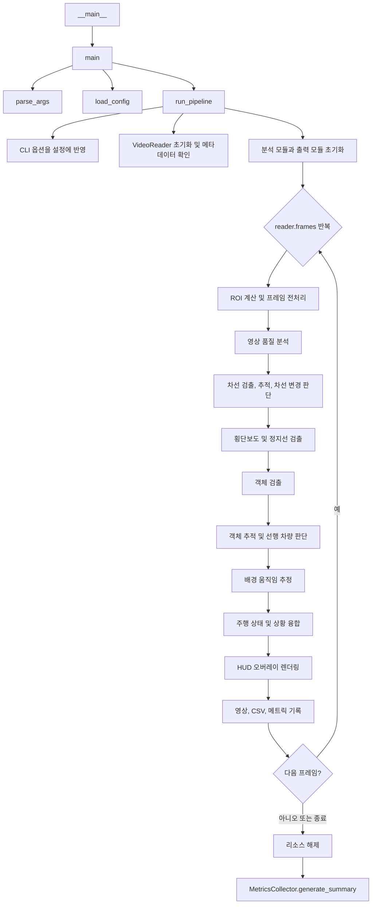

# dashcam_cv 실행 파이프라인

`src/main.py`를 기준으로 프로그램 진입부터 프레임 처리, 결과 저장, 종료까지의 함수 호출 흐름을 정리합니다.

## 1. 전체 호출 흐름



## 2. 시작 및 설정

1. `if __name__ == "__main__"` 블록이 실행되면 `main()`을 호출합니다.
2. `main()`은 `parse_args()`로 명령줄 인자를 읽고 `load_config(args.config)`으로 YAML 설정을 불러온 뒤 `run_pipeline(config, args)`를 호출합니다.
3. `parse_args()`는 설정 파일, 입력 영상, 출력 디렉터리, 처리 폭, 프레임 간격, 객체 검출 간격, 최대 프레임 수, 화면 표시 옵션을 받습니다.
4. `load_config()`은 설정 파일 존재 여부를 확인하고 YAML을 파이썬 딕셔너리로 읽습니다.
5. `run_pipeline()`은 지정된 CLI 값을 설정에 반영합니다. `--output-dir`가 주어지면 영상과 로그 파일 경로도 해당 디렉터리 아래로 변경합니다.

기본 설정은 `config/settings.yaml`에 정의되어 있습니다. 기본 입력은 `data/Test_Video_2.mp4`이며, 출력은 `outputs/`에 저장됩니다.

## 3. 파이프라인 초기화

`run_pipeline()`은 프레임 반복 전에 아래 객체를 초기화합니다.

- `VideoReader(input_path, target_width, frame_stride)`: 영상을 열고 원본/처리 해상도, FPS, 프레임 수 등의 메타데이터를 준비합니다.
- `FramePreprocessor(cfg)`, `QualityAnalyzer(cfg)`: 프레임 전처리 및 영상 품질 측정기입니다.
- `LaneDetector(cfg)`, `LaneTracker(cfg)`, `LaneChangeDetector(cfg)`: 차선 검출부터 시간적 추적과 차선 변경 판단까지 담당합니다.
- `RoadMarkingDetector(cfg)`: 횡단보도와 정지선을 검출합니다.
- `ObjectDetector(cfg)`, `ObjectTracker(cfg)`: 객체 검출 및 프레임 간 ID 추적을 담당합니다. 검출기는 설정에 따라 Ultralytics YOLO를 사용하고, 초기화에 실패하면 OpenCV 기반 검출기로 전환합니다.
- `MotionEstimator(cfg)`, `DecisionFusion(cfg)`: 배경 움직임을 추정하고 여러 분석 결과를 주행 상황으로 융합합니다. `DecisionFusion`은 배경 움직임과 영상 품질을 바탕으로 자차 상태를 신속하게 판단하고 다른 센싱 결과와 결합합니다.
- `HUDVisualizer(cfg)`: 차선, 객체, 상태와 성능 정보를 영상 프레임에 그립니다.
- `AnnotatedVideoWriter(...)`, `CSVLogger(...)`, `MetricsCollector(...)`: 주석 영상, 프레임별 CSV, 처리 통계 요약을 저장합니다.

## 4. 프레임별 처리 순서

`for ok, frame, frame_idx, timestamp in reader.frames(max_frames=max_frames)` 반복에서 유효한 프레임마다 다음 처리를 수행합니다.

### 4.1 프레임 입력과 전처리

1. `VideoReader.frames()`가 영상을 프레임 단위로 읽습니다. `frame_stride`에 해당하지 않는 프레임은 건너뛰고, 필요한 경우 목표 해상도로 크기를 변경합니다. 함께 프레임 번호와 타임스탬프를 반환합니다.
2. `get_roi_polygon(width, height, roi_cfg)`가 차선 분석 등에 사용할 사다리꼴 관심 영역(ROI)을 계산합니다.
3. `FramePreprocessor.process(frame)`가 BGR 프레임을 회색조로 바꾸고, 설정에 따라 CLAHE 대비 보정과 Gaussian blur를 적용한 뒤 Canny 에지를 계산합니다. 자동 임계값 옵션이 켜져 있으면 내부에서 `compute_auto_canny_thresholds()`를 호출하고, 마지막에 필요하면 morphology closing을 적용합니다. 반환값은 `gray`, `enhanced`, `edges`입니다.
4. `QualityAnalyzer.analyze(frame, gray)`가 평균 밝기와 Laplacian 분산을 이용해 밝기, 야간 여부, 블러 여부를 `QualityMetric`으로 만듭니다.

### 4.2 차선 검출과 차선 변경 판단

1. `LaneDetector.detect(frame)`가 `cv1021.py` 프로세스를 수행합니다:
   - 횡단보도(지브라 스트라이프 패턴)를 감지하고, 좌/우 독립 슬림 사다리꼴 ROI 및 압축 Bounding Box를 산출합니다.
   - 횡단보도 구간이 아닐 때 각 ROI를 슬라이싱(320x360) 후 CLAHE, GaussianBlur, Canny(50, 150) 전처리를 거쳐 `cv2.HoughLinesP(threshold=25, minLineLength=20, maxLineGap=60)`로 선분을 검출합니다.
   - 검출된 선분을 원본 프레임 좌표계로 역변환하고 기울기 조건을 필터링(횡단보도 가로선 및 수직 노이즈 배제)하여 좌/우 1차 회귀선(x = m*y + c)을 산출합니다. (횡단보도 감지 시에는 신규 측정을 배제하여 오검출 차단)
2. `LaneTracker.update(...)`가 좌/우 차선 각각에 독립된 4차원 등속도 칼만 필터(`SingleLaneKalmanFilter`)를 적용합니다:
   - 상태 벡터 $[m, c, dm, dc]^T$ 기반으로 프레임 간 떨림을 제거하고, 급격한 이상치(Innovation Gating: $|Δm| > 0.45$ 또는 $|Δc| > 160$)를 걸러냅니다.
   - 횡단보도나 가림 구간에서는 직전 속도 벡터를 기반으로 차선 위치를 정밀하게 예측(Predict)하며, 최대 30프레임 동안 상태를 유지합니다.
   - 차선 좌표, 중심 편차(error), 중심 경로, 상태를 `LaneResult`로 반환합니다.
3. `LaneChangeDetector.update(lane_res)`가 차선 중심 오차의 누적을 기준으로 `KEEPING`, `CANDIDATE`, `IN_PROGRESS` 상태를 판정합니다.


### 4.3 노면 표시와 객체

1. `RoadMarkingDetector.detect(frame, enhanced, edges)`가 ROI 내 밝은 가로 줄무늬를 이용해 횡단보도를, Hough 선분을 이용해 정지선을 검출합니다. 내부의 `_detect_crosswalk()`와 `_detect_stopline()`이 각각 두 작업을 수행합니다.
2. `ObjectDetector.detect(frame, frame_idx)`가 설정된 검출 간격에 맞는 프레임이면 검출을 실행하고, 그렇지 않으면 직전 검출 결과를 재사용합니다. YOLO 백엔드이면 `_detect_yolo()`를, 그 외에는 `_detect_opencv_fallback()`을 호출합니다. 반환값은 검출 객체와 이번 프레임에 실제 추론을 수행했는지 여부입니다.
3. `ObjectTracker.update(...)`가 새 검출 결과를 기존 추적과 연결합니다. 검출을 건너뛴 프레임에는 기존 객체 위치를 예측하고, 객체별 이동 상태·거리 추세를 계산합니다. 차로 중앙 앞쪽의 차량은 선행 차량으로 표시하고, 횡단보도가 검출된 경우 그 영역과 겹치는 보행자를 표시합니다.

### 4.4 움직임과 주행 상황 판단

1. `MotionEstimator.estimate(gray, tracked_objects)`가 객체 영역을 제외한 배경 특징점을 추적해 프레임 간 광학 흐름을 계산합니다. 특징점이 부족하거나 추적이 실패하면 신뢰 불가 결과를 반환하고, 충분하면 이동량의 중앙값을 `MotionResult`로 반환합니다.
2. `DecisionFusion.evaluate(...)`가 움직임(`MotionResult`)과 영상 품질(`QualityMetric`)로부터 자차 상태(주행, 정지 의심, 불확실)를 즉시 판단하고, 차선, 객체, 노면 표시, 차선 변경 상태와 함께 결합합니다.
3. `DecisionFusion.evaluate()`는 선행 차량과 보행자, 정지선, 차선 변경 정보를 함께 판단해 최종 상황을 만듭니다. 정지선과 횡단보도 검출은 여러 프레임에 걸쳐 유지하고, 위험 상태는 즉시 반영하며, 그 외 전환에는 디바운스와 유지 시간을 적용합니다.

### 4.5 시각화와 기록

1. `HUDVisualizer.draw(...)`가 원본 프레임에 차선, 주행 영역, 횡단보도·정지선, 객체 바운딩 박스, HUD 및 ROI 에지 미니맵을 그려 결과 프레임을 반환합니다.
2. `AnnotatedVideoWriter.write(vis_frame)`가 주석 프레임을 출력 영상에 기록합니다.
3. `CSVLogger.log(...)`가 상태·검출 결과를 `frame_log.csv`에, 단계별 처리 시간을 `performance.csv`에 기록합니다.
4. `MetricsCollector.record(...)`가 프레임별 처리 시간과 차선·상태·노면 표시·객체 통계를 누적합니다.
5. 프레임 번호가 30의 배수이면 현재 FPS와 자차 상태, 차선 상태, 객체 수를 콘솔에 출력합니다. 화면 표시가 활성화된 경우 `cv2.imshow()`로 영상을 표시하고, `q`는 종료, `p`는 일시정지, `d`는 디버그 미니맵 표시를 전환합니다.

## 5. 종료 및 결과 생성

프레임 반복이 정상 종료되거나 사용자가 종료를 요청하면 `finally` 블록에서 다음 리소스를 해제합니다.

- `VideoReader.release()`: 입력 영상 캡처를 닫습니다.
- `AnnotatedVideoWriter.release()`: 출력 영상 파일을 마무리합니다.
- `CSVLogger.close()`: CSV 파일을 flush하고 닫습니다.
- 화면 표시가 켜져 있으면 `cv2.destroyAllWindows()`를 호출합니다.

이후 `MetricsCollector.generate_summary()`가 누적 메트릭으로 평균/p95 지연 시간, 실효 FPS, 차선 검출률, 상태 분포 등을 계산해 `summary.json`으로 저장합니다. 처리한 프레임이 없으면 요약 대신 `{"error": "No frames processed"}`를 반환합니다.

## 6. 실행 예시

```bash
# 설정 파일 기본값으로 전체 영상 분석
python src/main.py

# 입력 영상과 처리 프레임 수 지정
python src/main.py --input data/Test_Video_2.mp4 --max-frames 100 --no-display

# 해상도, 프레임 간격, 객체 검출 간격 지정
python src/main.py --width 640 --stride 2 --detect-interval 5

# 별도 출력 디렉터리에 결과 저장
python src/main.py --output-dir outputs/run1
```
