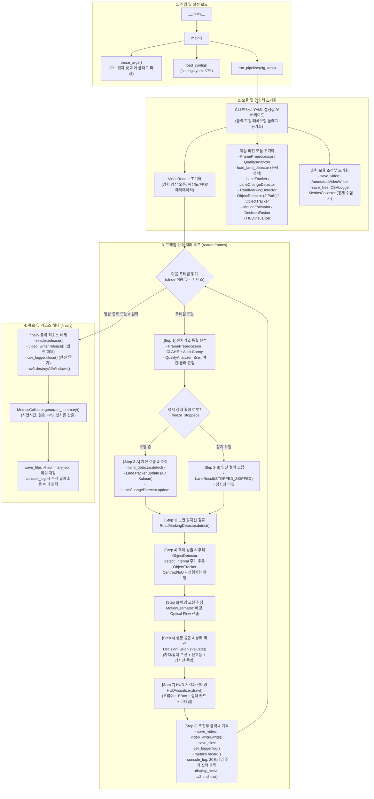

# dashcam_cv 실행 파이프라인

본 문서는 [`src/main.py`](file:///c:/gitclone/lane_detect_challenge/dashcam_cv/src/main.py)를 기준으로 프로그램 진입부터 설정 파싱, 모듈 초기화, 프레임 단위 비전 파이프라인 처리, 조건부 저장, 그리고 종료 시 통계 요약 보고서 생성까지의 전체 함수 및 모듈 호출 흐름을 정리한 가이드입니다.

---

## 1. 전체 파이프라인 아키텍처



---

## 2. 단계별 상세 실행 흐름

### 2.1 진입 및 설정 로드 (`main()`)

1. **`__main__` 진입**: 스크립트 실행 시 `main()` 함수를 호출합니다.
2. **`parse_args()` ([main.py](file:///c:/gitclone/lane_detect_challenge/dashcam_cv/src/main.py#L154))**: 명령줄 인자(CLI arguments)를 파싱합니다.
   - **입력/처리 제어**: `--input`, `--config`, `--width`, `--stride`, `--detect-interval`, `--max-frames`
   - **디스플레이 제어**: `--display`, `--no-display`
   - **차선 모듈 및 왜곡 보정**: `--lane-detector` (`lane_line` | `lanes_detector_v1_em`), `--undistort`, `--no-undistort`
   - **출력/로깅 제어 플래그**:
     - `--save-video` / `--no-save-video` : 주석 영상 저장 ON/OFF
     - `--save-files` / `--no-save-files` : CSV 로그 및 JSON 보고서 파일 저장 ON/OFF
     - `--console-log` / `--no-console-log` / `-q` (`--quiet`) : 콘솔 진행 출력 ON/OFF
3. **`load_config()` ([main.py](file:///c:/gitclone/lane_detect_challenge/dashcam_cv/src/main.py#L146))**: [`config/settings.yaml`](file:///c:/gitclone/lane_detect_challenge/dashcam_cv/config/settings.yaml) 파일을 읽어 파이썬 딕셔너리로 반환합니다.
4. **`run_pipeline(config, args)`**: 설정과 인자를 전달하여 주 파이프라인을 구동합니다.

---

### 2.2 파이프라인 초기화 (`run_pipeline()`)

1. **설정 동기화 및 플래그 확정**:
   - CLI 인자가 우선 적용되어 YAML 설정(`cfg["video"]`, `cfg["output"]`, `cfg["lane"]`)을 오버라이드합니다.
   - `save_video`, `save_files`, `console_log` 플래그가 확정됩니다.
2. **입력 비디오 리더 준비**:
   - [`VideoReader`](file:///c:/gitclone/lane_detect_challenge/dashcam_cv/src/video/video_reader.py)를 생성하여 동영상 파일을 열고 해상도(`width` x `height`), 총 프레임 수, FPS 등 메타데이터를 추출합니다.
3. **핵심 비전 인식 모듈 초기화**:
   - [`FramePreprocessor`](file:///c:/gitclone/lane_detect_challenge/dashcam_cv/src/video/preprocessing.py): CLAHE 평활화, 가우시안 블러, Auto-Canny 필터 준비
   - [`QualityAnalyzer`](file:///c:/gitclone/lane_detect_challenge/dashcam_cv/src/video/quality_analyzer.py): 야간 저조도 및 흔들림/블러 판정기
   - **`load_lane_detector()` ([main.py](file:///c:/gitclone/lane_detect_challenge/dashcam_cv/src/main.py#L134))**: 설정된 차선 검출기를 동적 로드
     - `lane_line`: `HighStabilityLaneTracker` (경량 고안정성 트래커)
     - `lanes_detector_v1_em`: `LanesDetectorV1EMAdapter` (광각 FOV 115° 렌즈 왜곡 보정 `CheckerboardCalibrator` 내장 모델)
   - [`LaneTracker`](file:///c:/gitclone/lane_detect_challenge/dashcam_cv/src/lane/lane_tracker.py): 4차원 등속도 칼만 필터(`SingleLaneKalmanFilter`) 기반 차로 시계열 추적기
   - [`LaneChangeDetector`](file:///c:/gitclone/lane_detect_challenge/dashcam_cv/src/lane/lane_change.py): 차로 중심 오차 드리프트 기반 변경 감지기
   - [`RoadMarkingDetector`](file:///c:/gitclone/lane_detect_challenge/dashcam_cv/src/objects/road_markings.py): 노면 정지선 수평선 탐지 및 안정화 모듈
   - [`ObjectDetector`](file:///c:/gitclone/lane_detect_challenge/dashcam_cv/src/objects/detector.py): Ultralytics YOLO 경량 모델(Nano) 기반 2-Path(일반 객체 + 신호등) 검출기
   - [`ObjectTracker`](file:///c:/gitclone/lane_detect_challenge/dashcam_cv/src/objects/object_tracker.py): Centroid/IoU ID 추적 및 선행 차량(Lead Vehicle) 주행 코리더 판별
   - [`MotionEstimator`](file:///c:/gitclone/lane_detect_challenge/dashcam_cv/src/state/motion_estimator.py): 배경 특징점 Optical Flow 기반 자차 움직임 추정기
   - [`DecisionFusion`](file:///c:/gitclone/lane_detect_challenge/dashcam_cv/src/state/decision_fusion.py): 멀티모달 센싱 정보 종합 주행 상태 머신
   - [`HUDVisualizer`](file:///c:/gitclone/lane_detect_challenge/dashcam_cv/src/common/visualizer.py): 주행 가이드라인, HUD 카드, 객체 박스 오버레이 렌더러
4. **출력 모듈 조건부 초기화**:
   - `save_video=True`인 경우에만 [`AnnotatedVideoWriter`](file:///c:/gitclone/lane_detect_challenge/dashcam_cv/src/output/video_writer.py) 인스턴스 생성 (False면 `None`)
   - `save_files=True`인 경우에만 [`CSVLogger`](file:///c:/gitclone/lane_detect_challenge/dashcam_cv/src/output/csv_logger.py) 인스턴스 생성 (False면 `None`)
   - [`MetricsCollector`](file:///c:/gitclone/lane_detect_challenge/dashcam_cv/src/output/metrics.py): 메모리 상 지연시간 통계 수집기 생성 (`save_files=False`이면 파일 경로 `None` 전달)

---

### 2.3 프레임 단위 처리 순서 (`reader.frames()`)

루프는 제너레이터를 통해 유효 프레임을 순회하며 아래 순서로 파이프라인을 실행합니다:

```
[입력 프레임]
     │
     ▼
[Step 1. 전처리 & 조도 분석]
     ├─ FramePreprocessor.process(frame) ──> gray, enhanced, edges
     └─ QualityAnalyzer.analyze(frame, gray) ──> QualityMetric (야간/블러 판정)
     │
     ▼
[Step 2. 차선 검출 & 추적]
     ├─ (정지 확정 시) ──> 검출 스킵 (연산 부하 절감)
     └─ (주행 중) ──> lane_detector.detect() ──> LaneTracker.update() ──> LaneChangeDetector.update()
     │
     ▼
[Step 3. 노면 표시 검출]
     └─ RoadMarkingDetector.detect() ──> 정지선(Stop line) 좌표 및 유지 상태
     │
     ▼
[Step 4. 객체 검출 & 추적]
     ├─ ObjectDetector.detect() ──> (detect_interval 주기마다 YOLO 추론)
     └─ ObjectTracker.update() ──> ID 추적, 주행 차로 내 선행 차량(Lead Vehicle) 판별
     │
     ▼
[Step 5. 배경 움직임 추정]
     └─ MotionEstimator.estimate() ──> 객체 영역 제외 배경 Optical Flow 크기/기울기 산출
     │
     ▼
[Step 6. 종합 상황 융합 (Decision Fusion)]
     └─ DecisionFusion.evaluate() ──> 자차 상태 (주행/감속/정지/불확실) + 위험 경고 (STOP/DECEL REQUIRED)
     │
     ▼
[Step 7. HUD 오버레이 렌더링]
     └─ HUDVisualizer.draw() ──> 반투명 주행 코리더 + BBox + 상태 대시보드 HUD 렌더링
     │
     ▼
[Step 8. 출력 저장 및 로깅]
     ├─ if video_writer: video_writer.write(vis_frame)
     ├─ if csv_logger: csv_logger.log(...)
     ├─ metrics.record(...)
     ├─ if console_log and frame_idx % 30 == 0: 진행 상태 터미널 출력
     └─ if display_active: cv2.imshow() & 키 입력 제어 ('q': 종료, 'p': 일시정지, 'd': 미니맵 토글)
```

#### 주요 최적화: 정지 확정 시 연산 스킵 (`freeze_stopped`)
- 자차 상태가 `STOPPED_SUSPECTED` 상태로 연속 `stopped_persistence_frames`(기본 15프레임) 이상 지속되면 정지 상태로 확정됩니다.
- 정지 상태에서는 차선과 노면 검출을 스킵하고 `LaneResult(status="STOPPED_SKIPPED")`로 대체하여 불필요한 연산 낭비를 방지합니다.

---

### 2.4 종료 및 결과 보고서 생성 (`finally`)

1. **안전한 자원 해제 (`finally` 블록)**:
   - `reader.release()`: 입력 비디오 스트림 닫기
   - `video_writer.release()`: `save_video=True`로 생성된 경우에만 정상 인코딩 마무리
   - `csv_logger.close()`: `save_files=True`로 생성된 경우에만 버퍼 flush 후 파일 닫기
   - `display_active=True`인 경우 `cv2.destroyAllWindows()`로 창 닫기
2. **요약 보고서 산출 (`MetricsCollector.generate_summary()`)**:
   - 총 처리 프레임 수, 평균/P95 파이프라인 지연 시간(ms), 실효 처리 FPS 산출
   - 모듈별(전처리, 차선, 객체, 추적, 모션, 융합, 렌더링) 평균 지연시간 분해
   - 차선 인식률, 주행 상태별 점유율(%), 검출 객체 통계 산출
   - `save_files=True`이면 `outputs/summary.json` 파일로 저장
3. **콘솔 배너 출력**:
   - `console_log=True`인 경우 터미널에 최종 통계 지표와 생성된 결과 파일 경로 목록을 출력합니다.

---

## 3. CLI 실행 옵션 레퍼런스

```bash
# 1. 기본 설정으로 전체 영상 실행
python src/main.py

# 2. 광각 렌즈 왜곡 보정 활성화 및 화면 표시
python src/main.py --undistort --display

# 3. 고속 벤치마크 (영상/파일 저장 및 콘솔 출력을 끄고 최대 처리 속도 측정)
python src/main.py --no-save-video --no-save-files --quiet

# 4. 해상도, 프레임 건너뛰기 간격, 객체 검출 주기 지정
python src/main.py --width 640 --stride 2 --detect-interval 5

# 5. 특정 출력 디렉터리로 결과 저장
python src/main.py --output-dir outputs/experiment_1
```
