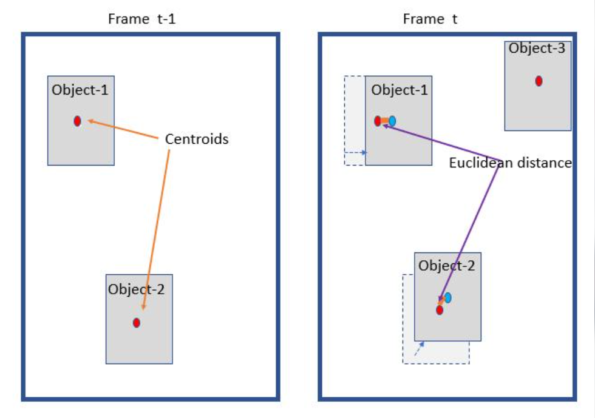
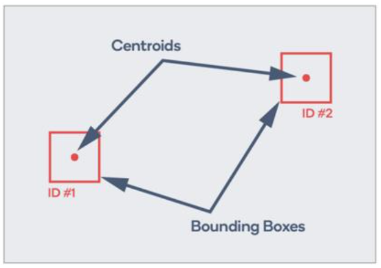
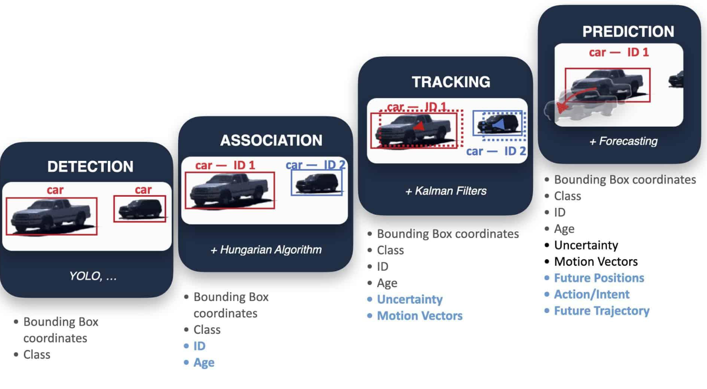
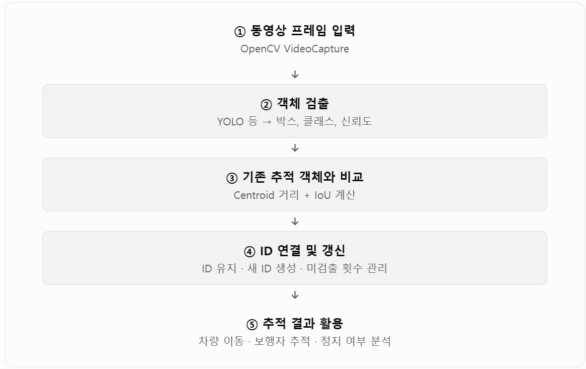
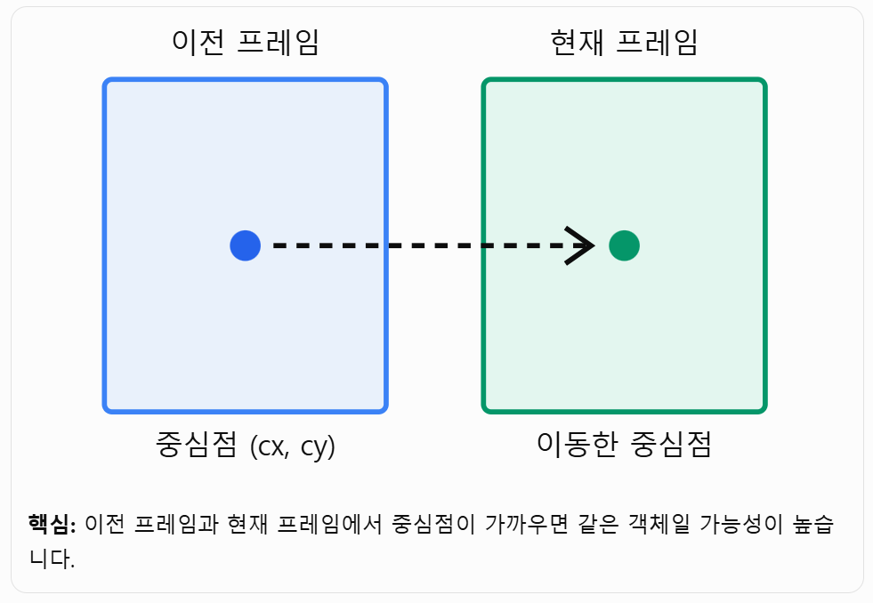
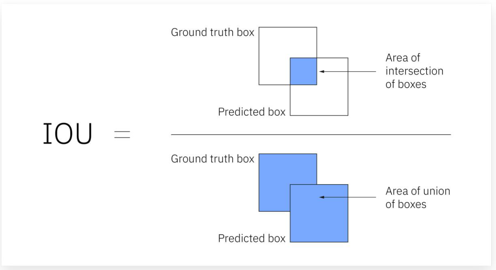
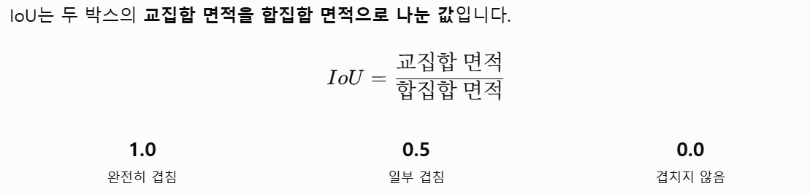
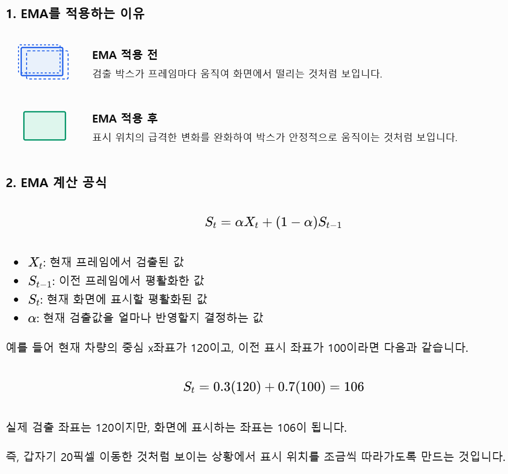

## 객체 추적(Object Tracking)

> `객체 검출(Object Detection)`: 현재 프레임에 자동차가 있는가?  
> `객체 추적(Object Tracking)`:이전 프레임의 자동차와 현재 프레임의 자동차가 같은 자동차인가?

- Centroid(중심점)와 IoU(박스겹침 비율)가 객체를 직접 검출하는 모델은 아닙니다. YOLO나 다른 검출기가 제공한 **바운딩 박스를 프레임 간에 연결**하는 역할
- Centroid와 IoU를 이용하면, 무거운 딥러닝 추적 모델 없이도 차량·보행자·자전거 등의 객체를 프레임 간에 연결하여 추적







#### 경량 트래커의 전체 처리 흐름
> `IoU 함수 구현` → `Centroid 계산` → 간단한 `ID 매칭` → `객체 미검출 처리` → YOLO `검출 결과 연결` → 차량 이동 및 정지 판단



### Centroid 기반 추적
Centroid는 객체를 감싸는 바운딩 박스의 중심점입니다.


예시)
(100, 200), 현재 중심점이 (108, 204)라면,  
$d=\sqrt{8^2+4^2}\approx8.94$  
거리가 설정한 임계값보다 작으면 같은 객체로 판단할 후보가 됩니다.  

**장점**: 계산이 매우 빠르고 구현이 쉽습니다.
**단점**: 차량 두 대가 가까이 지나가거나 객체가 서로 교차하면 ID가 바뀔 수 있습니다. 객체의 크기나 모양 변화도 충분히 반영하지 못합니다.

#### IoU 기반 추적
IoU는 Intersection over Union의 약자이며, 두 바운딩 박스가 얼마나 겹치는지 측정합니다.  

  


#### Centroid와 IoU를 함께 사용하는 이유

두 방법은 서로 보완적입니다.

|비교 항목|Centroid|IoU|
|---|---|---|
|비교 대상|중심점 사이 거리|박스 겹침 비율|
|객체 이동|중심점 이동으로 판단|박스의 겹침으로 판단|
|크기 변화 반영|직접 반영하지 않음|어느 정도 반영|
|객체가 빠르게 이동|거리가 멀어지면 연결 실패 가능|박스가 겹치지 않으면 연결 실패 가능|
|계산 비용|매우 낮음|낮음|
|주요 문제|가까운 객체 간 ID 혼동|겹치지 않는 박스의 연결 어려움|

실제 경량 추적기에서는 두 조건을 조합해 동일 객체 여부를 판단할 수 있습니다.
예를 들어 다음과 같은 규칙입니다.

- 중심점 거리가 충분히 가까움
- IoU가 일정 수준 이상임
- 두 조건을 종합한 점수가 가장 좋은 기존 ID를 선택함

다만, 중심점 거리와 IoU를 반드시 동시에 만족해야 하는 것은 아닙니다. 빠르게 이동하는 객체는 IoU가 낮더라도 중심점이 가까울 수 있고, 크기가 큰 객체는 중심점 이동이 있어도 박스가 겹칠 수 있습니다.


## Object_tracker.py 소스 분석

#### 전체 실행 흐름
1. `RoadMarkingDetector.detect(frame, enhanced, edges)`
    - `_detect_crosswalk()` ROI 내 밝은 가로 줄무늬를 이용해 횡단보도를, 
    - `_detect_stopline()` Hough 선분을 이용해 정지선을 검출합니다. 

2. `ObjectDetector.detect(frame, frame_idx)`
    - 설정된 검출 간격에 맞는 프레임이면 검출을 실행하고, 
    - 그렇지 않으면 직전 검출 결과를 재사용합니다. 
    - YOLO 백엔드이면 `_detect_yolo()`를, 그 외에는 `_detect_opencv_fallback()`을 호출합니다. 
    - 반환값은 검출 객체와 이번 프레임에 실제 추론을 수행했는지 여부입니다.

3. `ObjectTracker.update(...)`가 새 검출 결과를 기존 추적과 연결합니다.
    - 검출을 건너뛴 프레임에는 기존 객체 위치를 예측하고, 객체별 이동 상태·거리 추세를 계산합니다. 
    - 차로 중앙 앞쪽의 차량은 선행 차량으로 표시하고, 
    - 횡단보도가 검출된 경우 그 영역과 겹치는 보행자를 표시합니다.

#### 세부 내용

###### ObjectBox 데이터 객체에는 추적 중인 객체의 정보를 에 담습니다.

```python
ObjectBox(
    track_id=tid,
    bbox=track.bbox,
    class_id=track.class_id,
    label=track.label,
    confidence=track.confidence,
    center=track.center,
    velocity=track.velocity,
    is_lead=False,
    relative_distance_trend=trend,
    status=status
)
```

- `track_id`=tid: 추적기가 객체에 부여한 고유 ID입니다. 프레임이 바뀌어도 같은 객체를 구분하는 데 사용합니다.
- `bbox`=track.bbox: 객체를 감싸는 바운딩 박스 좌표 (x1, y1, x2, y2)입니다. 왼쪽 위와 오른쪽 아래 좌표를 뜻합니다.
- `class_id`=track.class_id: 모델이 분류한 객체 클래스의 숫자 ID입니다. 예를 들어 COCO 기준 2는 자동차입니다.
- `label`=track.label: 클래스 이름입니다. 예: "car", "person".
- `confidence`=track.confidence: 객체 검출에 대한 모델의 신뢰도 점수입니다. 보통 0~1 범위입니다.
- `center`=track.center: 바운딩 박스의 중심 좌표 (x, y)입니다.
- `velocity`=track.velocity: 추적 기록을 바탕으로 계산한 화면 좌표상의 이동 속도/방향 벡터입니다. 실제 도로 속도 단위(예: km/h)는 아닙니다.
- `is_lead`=False: 생성 시점에는 선행 차량이 아니라고 초기화합니다. 이후 차로 중앙 부근의 차량 중 조건에 맞는 후보가 선택되면 True로 바뀝니다.
- `relative_distance_trend`=trend: 객체 크기의 시간에 따른 변화를 이용한 상대 거리 추세입니다. 
    - "APPROACHING"은 가까워지는 것으로 판단, 
    - "RECEDING"은 멀어지는 것으로 판단, 
    - "STABLE"은 큰 변화가 없는 경우입니다. 
    - 충분한 추적 이력이 없으면 초기값 "UNKNOWN"입니다.
- `status`=status: 화면상 움직임 상태입니다. 차량의 실제 정차 여부를 직접 측정한 값은 아닙니다.
    - 추적기의 속도 크기가 기준보다 작으면 "STOPPED", 
    - 그렇지 않으면 "MOVING"입니다.
- `is_on_crosswalk`는 이 생성 코드에서 전달하지 않지만, ObjectBox의 기본값 False가 적용됩니다. 이후 객체가 횡단보도 위로 판별되면 별도로 True로 표시됩니다.


###### update 함수

```python
    def update(
        self,
        detections: List[ObjectBox],        # 검출 결과
        detection_executed: bool,           # 이번 프레임에서 검출 실행 여부
        lane: Optional[LaneResult],         # 차선 정보
        frame_shape: Tuple[int, int, int],  # 프레임 크기
        road_markings: Optional[Any] = None # 도로 표시 정보
    ) -> List[ObjectBox]:
```


```
함수 update(검출 결과, 이번 프레임에서 검출 실행 여부, 차선 정보, 프레임 크기, 도로 표시 정보):

    프레임 높이와 너비를 가져온다
    차선 중앙을 정한다
        차선 중앙 정보가 있으면 그 값을 사용
        없으면 화면 중앙을 사용

    만약 이번 프레임에서 객체 검출을 실행했다면:
        매칭된 트랙 ID 목록과 새 검출 객체 목록을 준비한다

        각 검출 객체에 대해:
            기존 트랙 중 아직 매칭되지 않은 것을 찾는다
            객체 라벨 호환성과 박스 겹침 정도(IoU), 중심 거리로 매칭 점수를 계산한다

            조건에 맞는 기존 트랙이 있으면:
                트랙 정보를 새 검출 결과로 갱신한다
                트랙 ID를 매칭 완료로 표시한다
            아니면:
                새 검출 객체 목록에 추가한다

        매칭되지 않은 기존 트랙은 위치를 예측하고 미검출 횟수를 늘린다
        미검출 횟수가 허용 한도를 넘은 트랙은 제거한다

        매칭되지 않은 새 검출 객체마다 새 트랙 ID를 발급해 등록한다

    아니면 (이번 프레임에서 검출을 건너뛰었다면):
        모든 트랙의 위치를 속도로 예측하고 미검출 횟수를 늘린다
        허용 한도를 넘은 트랙은 제거한다

    추적 중인 트랙마다:
        과거와 현재 바운딩 박스 크기를 비교해 접근/후퇴/안정 추세를 계산한다
        속도가 기준보다 작으면 정지, 아니면 이동 상태로 정한다
        트랙 정보를 ObjectBox로 만들어 결과 목록에 추가한다

        트럭·버스·자동차이고,
        차선 중앙에서 설정된 거리 이내이며, (settings.yaml의 lead_vehicle_corridor_margin_px에서 설정하며, 기본값은 130px)
        화면 높이의 절반보다 아래에 있으면:
            선행 차량 후보로 기록한다
            후보 중 바운딩 박스의 아래쪽이 가장 아래에 있는 차량을 선택한다

    선택된 후보의 is_lead를 True로 표시한다

    횡단보도 검출 정보가 있으면:
        각 사람 객체의 박스가 횡단보도 박스와 겹치는지 확인한다
        겹치면 is_on_crosswalk를 True로 표시한다

    추적 객체 목록을 반환한다
```


#### common/visualizer.py/draw 함수

현재 프레임과 분석 결과들을 받아, 정보를 그려 넣은 영상 프레임을 반환하는 함수입니다.

```python
    def draw(
        self,
        frame: np.ndarray,
        frame_idx: int,
        timestamp_sec: float,
        lane: LaneResult,
        objects: List[ObjectBox],
        markings: RoadMarkingResult,
        motion: MotionResult,
        state: DrivingStateResult,
        timings: FrameTimings,
        quality: QualityMetric,
        debug_edge_map: Optional[np.ndarray] = None
    ) -> np.ndarray
```

- `self`: Visualizer 객체 자신입니다. 설정이나 시각화 옵션에 접근할 때 사용합니다.
- `frame`: np.ndarray: 입력 영상 프레임입니다. 보통 OpenCV 형식의 이미지 배열(BGR)이며, 이 프레임을 복사해 시각화 결과를 그립니다.
- `frame_idx`: int: 현재 프레임의 번호입니다. HUD 등에 표시하거나 프레임을 식별하는 데 사용합니다.
- `timestamp_sec`: float: 영상 시작부터 현재 프레임까지의 시간(초)입니다. 재생 위치 표시 등에 사용합니다.
- `lane`: LaneResult: 차선 검출 결과입니다. 차선 경계, 주행 통로, 차선 상태 등을 그리는 데 사용합니다.
- `objects`: List[ObjectBox]: 추적된 객체 목록입니다. 차량·사람의 바운딩 박스와 라벨, 선행 차량 여부 등을 표시합니다.
- `markings`: RoadMarkingResult: 횡단보도와 정지선 검출 결과입니다. 해당 영역과 라벨을 프레임에 그리는 데 사용합니다.
- `motion`: MotionResult: 차량의 움직임 분석 결과입니다. 화면의 움직임·정차 관련 정보를 표시할 때 사용합니다.
- `state`: DrivingStateResult: 현재 주행 상태와 융합 판단 결과입니다. 예를 들어 감속·정지 같은 상태를 HUD에 표시합니다.
- `timings`: FrameTimings: 프레임 처리 단계별 시간 정보입니다. 처리 성능을 화면에 표시할 때 사용합니다.
- `quality`: QualityMetric: 프레임 품질 분석 결과입니다. 밝기나 흐림 여부 등을 표시하는 데 사용합니다.
- `debug_edge_map`: Optional[np.ndarray] = None: 선택적인 디버그용 에지 맵입니다. 전달하면 디버그 화면에 활용하고, 생략하거나 None이면 에지 맵 없이 시각화합니다.
- `반환값` -> np.ndarray: 시각화 요소가 그려진 출력 프레임입니다. 원본 frame을 직접 수정하는 대신 복사본에 그려 반환합니다.


## 성능 분석
```python
 "performance": {
    "processed_frames": 678,
    "effective_processing_fps": 46.27,   # 처리한 프레임 하나당 평균 지연시간을 밀리초(ms)
    "mean_total_ms": 21.61,
    "p95_total_ms": 45.14,
    "module_latency_mean_ms": {   # 처리한 프레임 하나당 평균 지연시간(ms)
      "decode": 0.0,
      "preprocess": 7.13,
      "lane": 2.18,
      "detect": 7.55,
      "tracking": 0.15,
      "motion": 2.28,
      "decision": 0.05,
      "render": 1.19
    }
```


. `module_latency_mean_ms`의 각 수치는 **처리한 프레임 하나당 평균 지연시간을 밀리초(ms)로 나타낸 것**입니다. `mean_total_ms`와 `p95_total_ms`도 프레임 처리시간이며, `effective_processing_fps`만 **초당 처리 프레임 수(FPS)**입니다.

|항목|값|의미|
|---|--:|---|
|`processed_frames`|678|실제 처리한 프레임 수|
|`effective_processing_fps`|46.27 FPS|초당 평균 처리 프레임 수|
|`mean_total_ms`|21.61ms|프레임 한 장을 처리하는 데 걸린 평균 시간|
|`p95_total_ms`|45.14ms|처리 프레임의 95%가 이 시간 이내에 완료됨. 나머지 5%는 더 오래 걸림|
|`decode`|0.00ms|영상 프레임 디코딩 시간. 0으로 측정됐거나 반올림·측정 범위에서 제외됐을 수 있어, 디코딩 작업이 실제로 전혀 없었다고 단정할 수는 없음|
|`preprocess`|7.13ms|프레임 크기 조정 등 모델 입력을 위한 전처리|
|`lane`|2.18ms|차선 검출 처리|
|`detect`|7.55ms|객체 검출 처리|
|`tracking`|0.15ms|객체 추적 및 ID 갱신|
|`motion`|2.28ms|움직임 분석|
|`decision`|0.05ms|검출 결과를 바탕으로 한 주행 판단|
|`render`|1.19ms|결과를 프레임 위에 그리는 시각화|

평균 총 처리시간 `21.61ms`를 FPS로 환산하면 약 **46.3 FPS**이므로, `effective_processing_fps`와 거의 일치합니다. 모듈별 평균을 더하면 약 **20.53ms**로 총 시간보다 조금 짧은데, 측정 범위에 차이가 있거나 모듈별 시간에 포함되지 않는 오버헤드가 있을 수 있습니다.


## 표시전용 EMA(Exponential Moving Average) 평활화
- EMA(Exponential Moving Average) : 지수이동평균
자율주행 영상 분석에서 표시전용 EMA 평활화는 객체의 실제 검출 결과는 그대로 유지하면서, 화면에 표시하는 위치나 값을 부드럽게 만드는 기법입니다
- 또한 객체 ID가 바뀌거나 객체가 오랫동안 검출되지 않았다가 다시 나타나는 경우에는 이전 EMA 값을 초기화하거나 재연결 여부를 확인
- 추적기에서 나온 detected_box를 변경하지 않고, display_box만 시각화에 사용




## 객체 검출
- GPU/CPU 장치 선택: CUDA와 GPU 아키텍처 지원 여부를 확인하고, 사용할 수 없으면 CPU로 실행하도록 추가했습니다.
- 추론 최적화: GPU에서는 FP16 시도 및 워밍업을 추가하고, GPU·CPU별 입력 크기를 설정할 수 있게 했습니다.
- 입력 영상 전처리: 하단의 기본 15%를 잘라내고, 영상 크기를 축소해 추론한 뒤 박스 좌표를 원본 크기로 되돌립니다. 야간 보정 기능도 추가됐습니다.
- 횡단보도 모델 지원: 별도 모델을 선택적으로 사용할 수 있게 했습니다. enable_crosswalk 기본값은 False라서, 설정에서 켜지 않으면 이 기능은 비활성 상태입니다.
- 구조 변경: 단일 YOLO 모델 호출에서 SubDetector를 통해 하나 이상의 검출기를 관리하는 방식으로 바뀌었습니다.
- 기본 모델 변경: yolov8n.pt에서 yolo26n.pt로 바뀌었습니다.

관련 구현은 detector.py의 장치 선택, NightEnhancer, SubDetector, ObjectDetector._detect_yolo에서 확인할 수 있습니다. 하단 영역을 자르는 변경은 본넷 오검출을 줄일 수 있지만, 가까운 객체가 화면 아래쪽에 걸리면 탐지에서 제외될 수도 있습니다.

#### detector.py 수도코드

1. 초기화 및 모델 준비  

```
설정에서 검출 활성화 여부, 모델, 검출 간격, 클래스, 해상도 등을 읽는다

검출이 꺼져 있으면:
    모델 준비 없이 종료

아니면:
    GPU 사용 가능 여부와 호환성을 확인한다
    GPU를 사용할 수 있으면 GPU 설정과 GPU용 해상도를 선택
    그렇지 않으면 CPU와 CPU용 해상도를 선택

    COCO 객체 검출 모델을 준비한다

    횡단보도 전용 검출이 설정으로 활성화되어 있으면:
        횡단보도 모델도 준비한다
        모델의 횡단보도 클래스를 내부 클래스 ID 100으로 매핑한다

    야간 보정이 활성화되어 있으면:
        야간 보정기를 준비한다

    모델 초기화에 실패하면:
        OpenCV 윤곽선 검출 폴백을 사용한다
```

2. 프레임별 검출 흐름
```
detect(frame, frame_idx)를 호출한다

검출이 꺼져 있으면:
    빈 객체 목록과 "이번 프레임에서 검출하지 않음"을 반환한다

이번 프레임이 검출 간격에 해당하지 않으면:
    이전 검출 결과를 반환한다
    "이번 프레임에서 새 검출을 하지 않음"을 함께 반환한다

이번 프레임에서 새 검출을 해야 하면:
    YOLO 모델이 준비되어 있으면:
        아래 YOLO 처리 흐름을 실행한다
    아니면:
        OpenCV 폴백 검출을 실행한다

    검출 결과를 캐시에 저장한다
    새 검출 결과와 "이번 프레임에서 검출함"을 반환한다
```

3. YOLO 검출 상세 흐름
```
프레임의 도로 영역을 잘라낸다
그레이스케일 변환과 대비 보정, 블러, 이진화를 수행한다
윤곽선을 찾는다

각 윤곽선의 크기와 가로세로 비율을 확인한다
사람 또는 자동차 후보 조건에 맞으면 ObjectBox를 만든다

후보 객체 목록을 반환한다
```

4. OpenCV 폴백 흐름
```
프레임의 도로 영역을 잘라낸다
그레이스케일 변환과 대비 보정, 블러, 이진화를 수행한다
윤곽선을 찾는다

각 윤곽선의 크기와 가로세로 비율을 확인한다
사람 또는 자동차 후보 조건에 맞으면 ObjectBox를 만든다

후보 객체 목록을 반환한다
```
여기서 detect()의 두 번째 반환값은 새 추론을 이번 프레임에서 실제 실행했는지 나타냅니다. 검출 간격 사이 프레임에서는 이전 캐시 결과를 반환하며, 호출부인 main.py는 이 값과 객체 목록을 추적기에 전달합니다.


#### 횡단보도 검출

두 방식은 **같은 횡단보도를 찾지만, 검출 방식과 결과의 쓰임새가 다릅니다.**

|비교 항목|`RoadMarkingDetector._detect_crosswalk()`|`detector.py`의 `SubDetector` 횡단보도 검출|
|---|---|---|
|방식|OpenCV 영상 처리 규칙|횡단보도 데이터로 학습된 YOLO 모델|
|처리 과정|도로 ROI에서 밝은 픽셀을 추출하고, 가로 줄무늬 후보를 찾아 최소 개수 이상이면 하나의 영역으로 묶음|별도 모델이 횡단보도 객체의 박스와 confidence를 예측|
|장점|가볍고 별도 모델 파일이 필요 없음. 조건이 맞는 노면 표시를 빠르게 찾음|일부 가림이나 패턴 변화에도 학습된 특징을 이용해 찾을 가능성이 있음|
|약점|밝기·그림자·노면 상태·시점에 영향을 받음. 횡단보도와 비슷한 흰 줄무늬도 오인할 수 있음|모델의 학습 데이터와 정확도에 좌우됨. 모델 로딩·메모리·추론 비용이 추가됨|
|현재 기본 설정|활성화|**비활성화** (`enable_crosswalk`의 기본값이 `False`)|

OpenCV 방식은 `road_markings.py의 _detect_crosswalk()`에서 밝기 임계값 180, 가로 형태 필터, 윤곽선의 크기·가로세로 비율을 확인합니다. 줄무늬 후보가 설정된 최소 개수 이상이면 전체를 감싸는 박스 하나를 반환합니다.

YOLO 방식은 `detector.py의 횡단보도 모델 초기화`에서 별도 모델을 추가하고, 찾은 클래스를 내부 ID `100`으로 매핑합니다. 다만 현재 `settings.yaml`에는 `enable_crosswalk: true`가 설정되어 있지 않으므로 실행 시 이 추가 모델은 기본적으로 사용되지 않습니다.


## 차선검출

#### 변경내용
최민혁님의 차선 검출 방식을 프로젝트의 차선 모듈과 메인 파이프라인에 적용했습니다.

**lane_detector.py**: 좌우 차선을 별도 ROI로 잘라 축소하고, CLAHE·Canny·Hough 변환으로 선분을 검출해 차선 피팅값을 만듭니다. 횡단보도가 검출된 프레임에서는 새 차선 측정을 건너뜁니다.
**lane_tracker.py**: 좌우 차선을 각각 칼만 필터로 평활화하고, 잠깐 검출되지 않을 때 위치를 예측합니다. 차선이 교차하는 측정값은 제외합니다.
**main.py**: 실험용 처리기를 빼고 새 검출·추적 결과를 LaneResult로 만들어 기존 판단·시각화 흐름에 전달하도록 연결했습니다.
**settings.yaml**: ROI 크기, 전처리, 허프 변환 등의 설정을 추가했습니다. 적용 내용은 파이프라인 문서에도 반영했습니다.
합성 차선 영상도 BOTH_DETECTED로 처리되어 중심 좌표가 반환되는 것을 확인했습니다. 기존 lanes_detector_v1_EM.py 파일은 남겨뒀지만, 메인 실행 경로에서는 더 이상 사용하지 않습니다.


#### 핵심 처리 단계
1. `횡단보도 검출` — detect_crosswalk()이 화면의 도로 영역을 잘라 회색조·CLAHE·임계값 처리를 하고, 가로 줄무늬 후보가 3개 이상이면 횡단보도로 판단합니다.

2. `좌우 ROI 차선 검출` — get_dual_roi_geometry()에서 좌우 차선을 따로 볼 영역을 계산합니다. 각 영역을 자르고 줄인 후 preprocess_roi()에서 CLAHE와 Canny를 적용합니다.

3. `차선 피팅` — Hough 변환으로 찾은 선분을 원본 프레임 좌표로 바꾸고, fit_lane_line()에서 선분의 기울기 방향에 따라 좌측 또는 우측 차선의 직선 피팅값을 구합니다.

4. `시간적 추적` — LaneTracker.update()가 좌우 차선에 독립적으로 칼만 필터를 적용합니다. 횡단보도 때문에 새 측정이 생략되거나 차선이 잠시 가려져도 이전 상태를 바탕으로 제한된 프레임 동안 위치를 예측합니다.

5. `화면 표시` — draw_dual_lane_overlay()가 차로와 차선을 프레임에 그립니다. 디버그 화면은 키 d, ROI 박스는 b로 표시 여부를 바꿀 수 있습니다.
참고로 차선 전처리 코드의 실제 처리는 Sobel이 아니라 CLAHE와 Canny입니다. 파일의 일부 주석에는 Sobel이라고 적혀 있지만, 현재 구현을 기준으로 설명했습니다.

#### 이은미, 최민혁 파이프라인 비교

|처리 단계|현재 `lane_detector.py`|`lanes_detector_v1_EM.py`|
|---|---|---|
|ROI 구성|좌측·우측을 **별도 사다리꼴 ROI**로 잘라 처리합니다.|하단 도로 영역 전체를 자른 뒤 **하나의 큰 사다리꼴 ROI**를 적용합니다.|
|전처리|각 ROI를 따로 리사이즈하고 CLAHE → 블러 → Canny를 적용합니다.|프레임을 640×360으로 처리하며, 도로 영역 전체에 CLAHE → 블러 → Canny를 적용하고 세로 팽창으로 끊긴 선을 연결합니다.|
|선 후보 분류|각 ROI의 Hough 선분을 기울기 방향으로 좌·우 구분합니다. 우측은 후보 군집을 나누고, 좌측 선이 있을 경우 차로 폭에 맞는 후보를 선택합니다.|전체 ROI에서 찾은 선을 기울기와 화면 내 위치로 좌·우 분류하고, IQR 이상치 제거와 선분 길이 가중 평균으로 대표선을 만듭니다.|
|시간에 따른 안정화|검출기가 피팅 결과를 내고, 별도 `LaneTracker`가 좌·우 칼만 필터로 추적합니다.|파일 안의 `ADASLaneTrackerV3`가 EMA 스무딩, 좌우 기하 검증, 한쪽 선이 없을 때 차로 폭 기반 보정, 최대 35프레임 유지를 수행합니다.|
|횡단보도·정지 처리|밝은 줄무늬 기반 횡단보도 검출을 하고, 횡단보도 감지 시 새 차선 측정을 건너뛰어 추적기의 예측값을 유지합니다.|엣지의 횡단보도 패턴과 프레임 차분으로 정지·주행을 판별하고, 조건에 따라 차선 표시를 일시 중단합니다.|
|실행·출력|`main.py`에서 사용되며, 피팅 결과와 디버그 정보를 반환합니다. 추적과 HUD 렌더링은 별도 모듈이 담당합니다.|독립 실행형 비디오 처리·시각화 파이프라인입니다. 자체 추적과 네온 색상 오버레이를 포함합니다.|

EM 방식이 평균 처리시간 기준 약 1.9배 빨랐습니다.

간단히 흐름을 나타내면 다음과 같습니다.

```
현재 lane_detector.py

프레임

→ 좌우 ROI 분리

→ 각 영역에서 Canny/Hough 선분 검출

→ 후보 선 피팅 및 우측 차로 폭 검증

→ 별도 LaneTracker의 칼만 필터

→ main.py의 시각화·결과 출력
```


```
lanes_detector_v1_EM.py

프레임

→ 하단 영역 및 통합 사다리꼴 ROI

→ Canny와 세로 팽창

→ 위치·기울기로 좌우 후보 분류

→ IQR/선분 길이로 대표선 계산

→ 파일 내부 추적기의 EMA·기하 검증·유지

→ 자체 오버레이 출력
```

**오른쪽 차선 오검출 관점**에서는 두 방식의 핵심 차이가 후보를 선택하는 방법입니다. EM 파일은 선의 위치·기울기와 좌우 경계 간격으로 잘못된 선을 걸러냅니다. 현재 검출기는 좌우 ROI를 분리해 인도 쪽 후보가 들어올 가능성을 줄이고, 좌측 경계가 함께 검출되면 차로 폭에 맞는 우측 후보를 선택하도록 보완했습니다. 대신 좌측 경계가 검출되지 않은 프레임에서는 현재 검출기의 차로 폭 검증이 적용되지 않는 차이가 있습니다.


#### 문제점
###### 우측차선 검출 오류
우측 ROI 안의 모든 오른쪽 기울기 선분을 한 번에 회귀해, 차선·도로 가장자리·차량 윤곽이 섞일 수 있습니다. 

**해결책**
- 우측 ROI 하단 바깥쪽을 0.72w에서 0.68w로 줄여, 이미지에서 보이는 인도·도로 가장자리 선이 후보에 들어올 가능성을 낮췄습니다
- 우측 Hough 선분들을 위치별 후보로 나누고, 좌측 차선도 검출된 경우 차로 폭이 타당한 후보 중 화면 중앙에 가까운 것을 선택


#### 수도코드(cv1021.py)
```
시작:
    사용할 입력 영상 파일을 후보 경로에서 찾는다
    영상 파일을 열 수 없으면 종료한다

    좌측 차선용 칼만 필터와 우측 차선용 칼만 필터를 준비한다
    디버그 표시, ROI 박스 표시, 일시정지 상태를 초기화한다

    영상이 열려 있는 동안 반복:
        일시정지 상태가 아니면:
            다음 프레임을 읽는다
            프레임을 읽지 못했으면 반복을 종료한다

            프레임 크기를 확인한다

            횡단보도를 검출한다
                ROI에서 밝은 영역을 추출한다
                가로 줄무늬 후보의 크기와 비율을 검사한다
                후보가 3개 이상이면 횡단보도로 판단한다

            좌우 차선용 ROI와 crop 영역을 계산한다

            횡단보도가 검출되지 않았다면:
                좌측 ROI를 자르고 마스크를 적용한 뒤 축소한다
                CLAHE와 Canny로 에지를 계산한다
                Hough 변환으로 선분을 검출하고 원본 좌표로 변환한다
                선분의 기울기와 방향을 검사해 좌측 차선 피팅값을 만든다

                우측 ROI에도 같은 처리를 수행해 우측 차선 피팅값을 만든다
            아니면:
                이번 프레임의 좌우 차선 측정값을 모두 없음으로 설정한다
                디버그 에지 이미지를 빈 화면으로 만든다

            좌측·우측 측정값을 각각 칼만 필터에 전달한다
                검출값이 있으면 필터 상태를 갱신한다
                검출값이 없으면 이전 상태로 위치를 예측한다
                미검출이 허용 프레임 수를 넘으면 필터를 초기화한다

            추적된 차선을 원본 프레임 위에 그린다
                횡단보도이면 ROI 안내 표시를 숨긴다
                유효한 차선이 있으면 차로 영역과 차선 경계를 표시한다

            디버그 모드이면 좌우 에지 이미지를 합쳐 화면에 표시한다
            결과 프레임을 창에 출력한다

        키 입력을 확인한다
            q: 종료
            b: ROI 바운딩 박스 표시 전환
            d: 에지 디버그 화면 표시 전환
            p: 일시정지/재생 전환

    영상과 화면 리소스를 해제한다
```
